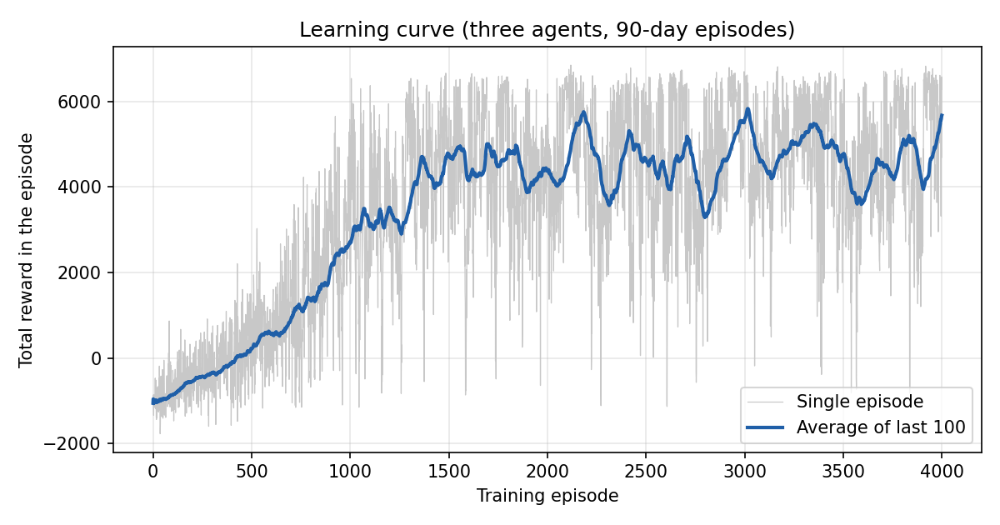
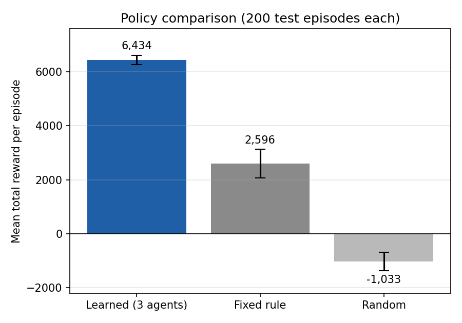

# AI-Powered Supply Chain Risk Prediction and Autonomous Decision-Making System

Three reinforcement-learning agents learn to run the stock of one product:
one decides how much to reorder, one picks the supplier, and one picks the
shipping method. They learn by trial and error in a simulated supply chain
whose demand and delivery delays are taken from the real DataCo Smart Supply
Chain dataset.

The project includes the simulator, the agents, training and experiment
scripts, a written report, a slide deck, and an interactive dashboard.



## Quick start

You need Python 3.9 or newer.

```bash
# 1. create and activate a virtual environment (recommended)
python -m venv venv
source venv/bin/activate          # Windows: venv\Scripts\activate

# 2. install the dependencies
pip install -r requirements.txt

# 3. open the dashboard
streamlit run dashboard/app.py
```

The dashboard opens in your browser. It uses pre-trained agents, so there is
nothing to wait for. If `python` is not found on Mac or Linux, use `python3`.

## What you can do in the dashboard

- **Live simulation**: step through a 90-day episode and watch what each agent
  decides, in plain language, along with stock levels and reward.
- **Compare policies**: test the learned agents against a simple fixed rule and
  against random decisions over many episodes.
- **What the agents learned**: a readable version of each agent's Q-table, with
  how often each situation actually comes up.

The sidebar sliders change supplier reliability and demand volatility, so you
can see how the trained agents cope when conditions differ from training.

## Reproducing the results

All of these run from the project root and take a few seconds each.

```bash
python -m pytest tests -v                      # 19 tests
python training/train_single_agent.py          # only the inventory agent learns
python training/train_multi_agent.py           # all three agents learn
python training/train_multi_agent.py --save --plots   # also rewrite the dashboard's
                                                      # Q-tables and the figures in results/
python experiments/run_experiments.py          # experiments 1, 3, 4 and 7
python experiments/run_experiment6.py          # experiment 6
```

Training uses fixed random seeds, so you should get the same numbers as below.

## Results

Average total reward over a 90-day episode, 200 test episodes each:

| Policy | Mean reward | Std |
|---|---|---|
| Three learned agents | 6,434.17 | 169.16 |
| Fixed rule (reorder 1,000 below 400 units, Supplier A, standard shipping) | 2,596.45 | 526.12 |
| Random decisions | -1,032.85 | 343.71 |



The learning curve at the top is lower than these test numbers because during
training the agents still take random exploratory actions. The test runs use
only the best-known action.

The experiments (exploration rate, supplier reliability, demand volatility,
shared vs. hybrid reward) are summarised in the report. Each condition is a
single training run, so small differences between conditions should not be
over-read.

## How it works

**Environment.** One product, one warehouse (capacity 3,000 units), two
suppliers and four shipping modes. Each day the agents act, demand is drawn,
orders arrive, and a single shared reward is computed:

```
reward = units sold
         - 2.0 x units of unmet demand
         - 0.1 x units above 70% of warehouse capacity
         - 1.5 x late shipments arriving
         - 0.01 x transport cost
         - 1 if a supplier failed to deliver
```

**Agents.** Each agent has its own Q-table and updates it with standard
Q-learning (learning rate 0.1, discount 0.9, exploration decaying from 1.0 to
0.05). The learning code is written from scratch in `agents/q_learning.py`.

| Agent | Sees | Chooses |
|---|---|---|
| Inventory | stock level, amount on order | reorder 0, 500, 1,000 or 1,500 units |
| Supplier | stock level | Supplier A, Supplier B, or split the order |
| Logistics | stock level, amount on order | Standard, Second, First Class or Same Day |

The agents are linked through the environment: the inventory agent's order size
decides whether the other two choices matter that day, the supplier decides
how likely the order is to fail, and the shipping mode decides how late it may
be. All three share one reward, so they are rewarded for working together.

## What is real and what is simulated

| Part | Source |
|---|---|
| Daily demand | Real. Sampled from 1,006 days of actual sales of one DataCo product |
| Delay probability and duration per shipping mode | Real. Calculated from DataCo delivery records |
| Product price | Real DataCo field |
| Suppliers (reliability, lead time, cost) | Simulated. DataCo has no supplier data |
| Inventory, warehouse capacity, holding cost | Simulated |
| Transport cost | Simulated. DataCo records the mode and duration, not the cost |

`data/calibration.json` holds the numbers calculated from DataCo (the demand
pool and the shipping-mode statistics). The full dataset is not included
because of its size. It is available at
https://data.mendeley.com/datasets/8gx2fvg2k6/5

## Project layout

```
dashboard/
    app.py                      Streamlit dashboard
    trained_qtables.json        trained agents, loaded by the dashboard
environment/
    supply_chain_env.py         the simulator
    discretization.py           groups raw stock levels into bands for the Q-tables
agents/
    q_learning.py               tabular Q-learning agent
training/
    train_single_agent.py       inventory agent only
    train_multi_agent.py        all three agents (main script)
experiments/
    run_experiments.py          experiments 1, 3, 4, 7
    run_experiment6.py          experiment 6
tests/                          unit tests for the environment and the agent
data/calibration.json           statistics taken from DataCo
results/                        figures made by train_multi_agent.py --plots
report/project_report.md        full written report
presentation.pptx               slide deck
presentation_companion.md       speaking notes and Q&A preparation
```

## Limitations

- Each experiment condition was trained once with one seed.
- Supplier behaviour is entirely simulated, so what the supplier agent learns
  reflects our assumptions, not real suppliers.
- About 80% of days in the test runs involve no reorder, and on those days the
  supplier and shipping choices have no effect.
- Only one product is modelled.

More detail is in the report.

## Dataset

Constante, F., Silva, F., Pereira, A. (2019). *DataCo Smart Supply Chain for Big
Data Analysis*. Mendeley Data, V5. https://doi.org/10.17632/8gx2fvg2k6.5
